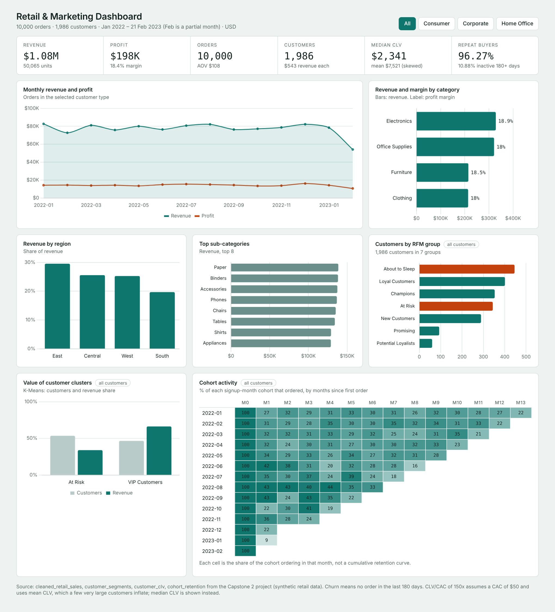
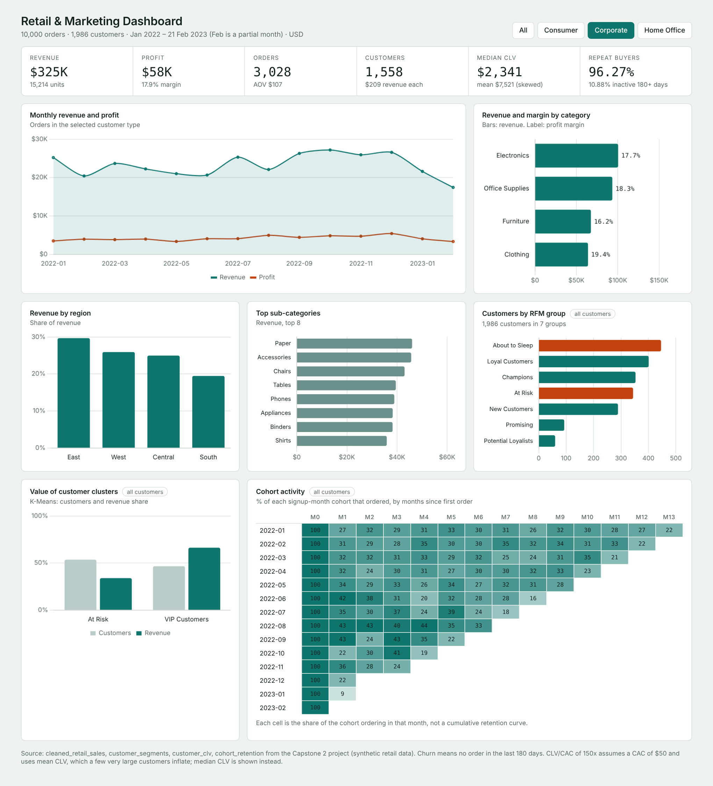

# Retail & Marketing Analytics
**Customer segmentation, RFM, cohort analysis and sales KPIs for a multi-region retailer**

End-to-end analytics on a synthetic retail dataset: 10,000 orders from 1,986 customers across 4 regions and 4 product categories (Jan 2022 – Feb 2023). Covers data cleaning, EDA, RFM scoring, K-Means clustering, cohort analysis, CLV and a KPI framework for dashboards.



> The screenshot is an interactive HTML dashboard preview of the project's metrics. Power BI measures, theme and build steps are in [`powerbi/`](powerbi/).

## Key results
| Metric | Result |
|---|---|
| Revenue / profit | $1.08M / $198K (18.4% margin) |
| Orders / customers | 10,000 / 1,986 |
| Average order value | $107.87 |
| Top category | Electronics, 30.4% of revenue |
| Repeat customers | 96.3% (1,912 of 1,986) |
| Inactive 180+ days (churn proxy) | 10.9% (216 customers) |
| Median CLV | $2,341 (mean $7,521, inflated by a few very large customers) |
| VIP cluster | 46.5% of customers, 66.2% of revenue |

## What I did
1. **Cleaning:** filled 80 missing values, treated outliers (IQR winsorisation on sales, quantity, profit), engineered 26 features (time, revenue, customer, delivery).
2. **EDA:** category, region, seasonality and Pareto analysis (top 20% of products = 27.3% of revenue).
3. **RFM and clustering:** RFM scoring into 7 groups; K-Means with silhouette/elbow checks produced two clusters (VIP, At Risk).
4. **Cohorts and CLV:** monthly signup cohorts with month-by-month activity; simple CLV per customer.
5. **KPIs and dashboard:** revenue, profit, AOV, churn, CLV and payback metrics; Power BI model and DAX measures included.

## Structure
```
data/raw, data/processed   source and derived CSVs
notebooks/                 main notebook and step scripts 01-05
figures/                   static charts (interactive Plotly HTML files not included)
reports/                   executive summary, KPI tables, cleaning and EDA reports, project PDF
screenshots/               dashboard previews
powerbi/                   DAX measures, theme, build guide
docs/                      data dictionary
```

## Dashboard screenshots
| All customers | Corporate filter |
|---|---|
|  |  |

## Tech stack
Python (pandas, NumPy, scikit-learn, Plotly, Matplotlib, Seaborn), Power BI / DAX.

## Notes and limitations
- The data is synthetic, so patterns such as flat monthly revenue and near-identical category margins illustrate the method rather than a real business.
- CLV/CAC of 150x uses an assumed $50 CAC and the mean CLV, which a few outliers inflate. Treat it as illustrative; median CLV is the safer figure.
- February 2023 is a partial month (data ends 21 Feb).
- Churn is defined as no order in the last 180 days of the data window.
- The expected-impact percentages in the executive summary are targets, not measured results.

**Author:** Ruturaj Patil · [LinkedIn](https://www.linkedin.com/in/ruturaj-patil-85119522b/) · [GitHub](https://github.com/Ruturaj2601)
